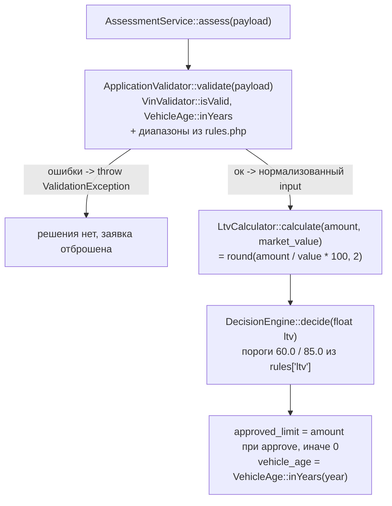

# Карта кода: как считается решение approve / review / reject

Разбор `backend/src/Domain/` и `backend/config/rules.php`: какие файлы участвуют,
какие функции вызываются и в каком порядке. Описано состояние кода на момент
написания; всё, чего в коде нет, отмечено словом «нет».

## 1. Как считается решение: файлы и порядок вызовов

Сборка: `AppFactory::create()` (`backend/src/AppFactory.php:30-39`) читает
`backend/config/rules.php` и передаёт его куски в конструкторы:
`VinValidator($rules['vin'])`, `ApplicationValidator($rules, ...)`,
`DecisionEngine($rules['ltv'])`.

Точка входа — `AssessmentService::assess(array $payload)` (`AssessmentService.php:28`).
Порядок:

1. **Валидация** — `ApplicationValidator::validate()` (`ApplicationValidator.php:24`).
   Проверяет каждое поле, ошибки собирает в `$errors`; если он непуст —
   `throw new ValidationException($errors)` (`ValidationException.php`), заявка
   дальше не идёт, решения нет. Правила берёт из `rules.php`:
   - `vin` → `VinValidator::isValid()` (`VinValidator.php:18`): длина 17
     (`vin.length`), только `A-Z0-9`, без `I/O/Q` (`vin.forbidden_chars`);
   - `year` → через `VehicleAge::inYears()` (`VehicleAge.php:18`, это
     `currentYear - year`, где `currentYear = (int) date('Y')` задаётся в
     `AppFactory.php:34,38`): не раньше 1990 (`vehicle.min_year`), возраст >= 0
     и <= 20 (`vehicle.max_age_years`);
   - `mileage` → от 0 до 500 000 (`vehicle.max_mileage_km`) — детали в п. 4;
   - `market_value` > 0; `requested_amount` — 50 000…2 000 000
     (`amount.min/max`); `term_months` — 3…48 (`term.min_months/max_months`).

   Успех → возвращает нормализованный массив
   `{vin, year, mileage, market_value, requested_amount, term_months}`.
2. **LTV** — `LtvCalculator::calculate(requested_amount, market_value)`
   (`LtvCalculator.php:15`): процент с двумя знаками, `round(...)`. Внутри есть
   guard-проверки «больше нуля» (`InvalidArgumentException`), но при вызове из
   `assess()` они недостижимы — валидатор уже отсек неположительные значения.
3. **Решение** — `DecisionEngine::decide(float $ltv)` (`DecisionEngine.php:30`).
   Пороги приходят в конструктор из `rules['ltv']`
   (`approve_max = 60.0`, `review_max = 85.0`):
   - `$ltv < 60.0` → `APPROVE`;
   - `$ltv <= 85.0` → `REVIEW`;
   - иначе → `REJECT`.
4. **Ответ** — обратно в `assess()` (`AssessmentService.php:35-41`):
   `approved_limit = requested_amount` при approve, иначе 0; плюс `vehicle_age`
   через `VehicleAge::inYears()`.

Два замеченных факта, без интерпретации:

- Комментарий в `rules.php:39` и docblock `DecisionEngine` говорят
  «`LTV <= approve_max` → approve», но код проверяет строго
  `$ltv < $this->approveMax` (`DecisionEngine.php:32`): при LTV ровно 60.0 код
  вернёт `review`.
- `ltv_by_age` (`rules.php:53-58`) кодом не используется вообще (только
  определение в конфиге и упоминание в docblock `AssessmentService.php:12`) —
  лимит по нему не считается, задача LOAN-12.

## 2. Куда встанет правило «пробег <= 400 000 км, иначе review»

**Функция:** `DecisionEngine::decide()` — единственное место, где рождается
approve/review/reject. Конкретно: после LTV-порогов добавить проверку «если
пробег > порога, решение не ниже review».

**Но по данным есть зазор.** Сейчас `decide()` принимает только `float $ltv`
(`DecisionEngine.php:30`), а конструктор — только пороги LTV
(`DecisionEngine.php:23-28`). Поэтому правило потребует:

**Есть:**

- пробег уже есть на всём пути до точки вызова: `ApplicationValidator`
  нормализует его в int (`ApplicationValidator.php:43`, возвращает в
  `$input['mileage']`, строка 78), и `$input` целиком доступен в
  `AssessmentService::assess()` в момент вызова
  `$this->decisionEngine->decide($ltv)` (`AssessmentService.php:32-33`);
- поле `mileage` приходит из формы заявки, пишется в БД
  (`ApplicationRepository.php:38-45`);
- секция `vehicle` в `rules.php`, куда по конвенции кладут числа, существует.

**Не хватает:**

1. самого порога 400 000 в `rules.php` — такого ключа нет (есть только
   `max_mileage_km = 500000`, это другая, валидационная граница);
2. передачи пробега в `DecisionEngine` — придётся расширить сигнатуру
   `decide()` (например, `decide(float $ltv, int $mileage)`) и конструктор
   (новое правило из конфига), а вместе с этим точку сборки `AppFactory.php:37`
   и тесты, которые создают движок только с двумя порогами
   (`tests/Unit/DecisionEngineTest.php:17`,
   `tests/Unit/AssessmentServiceTest.php:27`);
3. самой логики «пробег → решение» — её нет нигде;
4. определённости семантики: в коде нет ничего, что говорит, что делать при
   конфликте (например, пробег > порога и одновременно LTV > 85 — оставить
   `reject` или заменить на `review`). Это надо определить в самом правиле, в
   коде ответа нет.

**Граница срабатывания:** из-за существующей валидации правило реально
различает только пробег в диапазоне (400 000 … 500 000] — всё, что больше
500 000, отбрасывается ещё в `ApplicationValidator` с `ValidationException`
и до решения не доходит.

## 3. Что прямо сейчас проверяется про пробег

- `rules.php:23` — `vehicle.max_mileage_km = 500000`.
- `ApplicationValidator.php:43-46` — пробег приводится к int (отсутствующее
  поле → `-1`, т.е. «пустой пробег» — ошибка валидации) и должен быть
  `0 <= mileage <= 500000`; иначе в `$errors['mileage']` попадает сообщение
  «Пробег от 0 до 500000 км» и вся заявка падает с `ValidationException` — до
  расчёта LTV и решения.
- Пробег проходит «сквозь» сервис: попадает в нормализованный `$input`,
  возвращается наружу в ответе (`'input' => $input`, `AssessmentService.php:40`)
  и пишется в БД (`ApplicationRepository.php:38-45`, колонка `mileage_km` в
  `db/schema.sql:22`).
- **На решение approve/review/reject пробег сейчас не влияет никак.**
  `LtvCalculator`, `DecisionEngine`, `VehicleAge`, `VinValidator` про пробег
  не знают — нет.

Для контекста: это правило в репозитории уже ожидается — в
`docs/spec/README.md:10` для задачи MILEAGE перечислены граничные значения
399999 / 400000 / 400001 и требование определить поведение при пустом или
неизвестном значении.
